# 🤖 Intelligent Code Assistant

An AI-powered coding assistant that helps developers understand code, find relevant code snippets, and get programming assistance using **Generative AI and Retrieval-Augmented Generation (RAG)**.

## 📌 Project Overview

The Intelligent Code Assistant is designed to make programming easier by combining code retrieval techniques with large language models (LLMs). It helps users ask questions about code and receive context-aware explanations and suggestions.

The project explores how code chunking, embeddings, semantic search, and retrieval techniques can improve the relevance of AI-generated responses.

## ✨ Key Features

- 🤖 **AI-Powered Code Assistance** — Get explanations and programming guidance.
- 🔍 **Code Retrieval** — Retrieve relevant code snippets based on user queries.
- 🧠 **Retrieval-Augmented Generation (RAG)** — Use retrieved context to support more relevant responses.
- 🔢 **Code Embeddings** — Represent code and queries as vectors for semantic similarity search.
- 🔀 **Hybrid Search** — Combine semantic and keyword-based retrieval techniques.
- 🎯 **Reranking** — Improve the relevance of retrieved results before generating a response.
- 💬 **Natural Language Queries** — Ask questions about programming concepts and code.
- ⚡ **LLM Integration** — Generate responses using a compatible language model.

## 🏗️ How It Works

```mermaid
flowchart TD
    A[Code Files] --> B[Code Chunking]
    B --> C[Embedding Generation]
    C --> D[Vector Search]
    A --> E[Keyword Search]
    D --> F[Hybrid Retrieval]
    E --> F
    F --> G[Result Reranking]
    G --> H[Relevant Code Context]
    H --> I[LLM]
    J[User Query] --> F
    J --> I
    I --> K[AI-Generated Response]
```



1. **Code Ingestion:** Load source code and divide it into manageable chunks.
2. **Embedding Generation:** Convert code chunks and queries into vector representations.
3. **Hybrid Retrieval:** Retrieve relevant results using semantic and keyword search.
4. **Reranking:** Prioritize the most relevant retrieved code snippets.
5. **Response Generation:** Provide the retrieved context and user query to an LLM.
6. **Answer Delivery:** Return a context-aware explanation or programming response.

## 🛠️ Technology Stack

- **Language:** Python
- **AI Approach:** Generative AI and RAG
- **Embeddings:** Text or code embedding models
- **Retrieval:** Vector search and keyword-based search
- **Vector Store:** FAISS
- **Keyword Search:** BM25
- **Reranking:** FlashRank
- **LLM Integration:** Groq API or another compatible provider

*Confirm these technologies against the actual source code and dependency files before publishing.*

## ⚙️ Installation and Setup

### 1. Clone the repository

```bash
git clone https://github.com/dhilleswar07/Intelligent_Code_Assistant.git
```

### 2. Navigate to the project directory

```bash
cd Intelligent_Code_Assistant
```

### 3. Create a virtual environment

```bash
python -m venv .venv
```

Activate the environment on Windows:

```powershell
.venv\Scripts\Activate.ps1
```

### 4. Install dependencies

If the project contains a `requirements.txt` file, run:

```bash
pip install -r requirements.txt
```

Otherwise, install the dependencies listed in the project's imports and setup instructions.

### 5. Configure API credentials

If your chosen LLM provider requires an API key, create a `.env` file in the appropriate directory.

Example:

```env
GROQ_API_KEY=your_api_key_here
```

Use the environment variable expected by your code. Never upload real API keys or secrets to GitHub.

### 6. Run the application

Follow the entry-point instructions in the repository. For a Python script, use:

```bash
python filename.py
```

Replace `filename.py` with the actual application entry point.

## 🎯 Use Cases

- Understanding unfamiliar codebases
- Finding relevant code snippets
- Explaining programming logic
- Exploring AI-assisted software development
- Learning how RAG improves LLM applications
- Building intelligent developer tools

## 🔮 Future Enhancements

- Support additional programming languages.
- Add repository-wide code understanding.
- Integrate automated debugging and error explanations.
- Introduce code generation and refactoring assistance.
- Add conversation memory for follow-up questions.
- Build a web interface for interactive code exploration.
- Evaluate retrieval quality and response accuracy.

## 👨‍💻 Author

**Dhilleswar Jogi**

- GitHub: [@dhilleswar07](https://github.com/dhilleswar07)
- Repository: [Intelligent Code Assistant](https://github.com/dhilleswar07/Intelligent_Code_Assistant)

## 📄 License

Refer to the repository's license file for applicable usage and distribution terms.

---

⭐ If you find this project useful, consider giving the repository a star!

